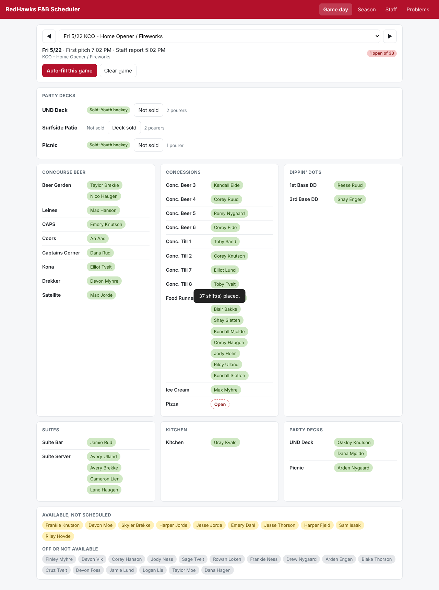

# RedHawks F&B Scheduler

Staff scheduling for RedHawks food and beverage: who works each home game, which stand, which role. Runs on Google Sheets with an Apps Script web app on top.

- Code: `src/` (`Code.gs`, `App.html`, `appsscript.json`)
- Sheet setup and demo script: [docs/SETUP.md](docs/SETUP.md)
- Rules for anyone (or any AI) changing the code: [AGENTS.md](AGENTS.md)

## How changes reach the live app
1. Someone opens a pull request. The Checks workflow syntax-checks the code.
2. Will reviews and merges it.
3. Will runs **Actions > Deploy to Apps Script > Run workflow**. It pushes `src/` into the sheet's Apps Script project and moves the existing web app deployment to the new version, so the link stays the same.

One-time setup for deploys (repo Settings > Secrets and variables > Actions):
- Secret `CLASPRC_JSON`: the contents of `~/.clasprc.json` after running `npx @google/clasp@2.4.2 login` as the sheet owner. Turn on the Apps Script API first at https://script.google.com/home/usersettings.
- Variable `SCRIPT_ID`: Apps Script editor > Project Settings > Script ID.
- Variable `DEPLOYMENT_ID`: Deploy > Manage deployments > the web app's Deployment ID.

Deploying replaces every file in the Apps Script project with what's in `src/`. Don't edit code in the Apps Script editor directly any more, or it will be overwritten on the next deploy.
